# Process map

How one invoice travels from PDF to decision. The full detail is in `SPEC.md` section 3; this
page is the picture and the plain-English version.

**The one rule: the AI model reads; code decides.** The model is used only in stage 2 (Extract)
to turn the PDF into a structured record. Stages 3 to 6 are ordinary code, so the same inputs
always give the same decision.

**Collect everything.** Stages 3 to 5 never stop at the first problem. Every check that can run
does run, and each one records a *finding*. A check that cannot run because of an earlier
problem is recorded as *skipped*, with the reason. The reviewer gets one complete list.

Each finding carries a severity: `info` (no effect), `review` (a person must look) or `reject`.
The arrows below show which severity each outcome produces. Only stages 1 and 2 can halt a run.

## Flowchart

```mermaid
flowchart TD
    IN([Invoice PDF submitted]) --> R

    subgraph S1["1 Receive (no AI)"]
        R{PDF, at most 10 MB<br/>and 5 pages?}
        R -- yes --> R2[Compute SHA-256 hash<br/>Render pages to PNG]
        R2 --> R3{Same hash as<br/>an earlier run?}
    end
    R -- no --> HALT1([Upload refused with a clear error])

    subgraph S2["2 Extract (AI: the only model call)"]
        E0[Reuse stored extraction<br/>labelled 'reused: identical file']
        E1{Daily live-call<br/>cap reached?}
        E2[Send PDF to the model<br/>60 s timeout, up to 2 retries]
        E3{Call succeeded?}
        E4[Save extraction by file hash]
        E5{Saved result exists for this hash<br/>and cache mode is 'fallback'?}
        E6[Use saved result, labelled<br/>'served from saved result']
        REC[/Structured invoice record<br/>absent fields are null, never guessed/]
    end
    R3 -- yes --> E0 --> REC
    R3 -- no --> E1
    E1 -- no --> E2 --> E3
    E3 -- yes --> E4 --> REC
    E3 -- no --> E5
    E1 -- yes --> E5
    E5 -- yes --> E6 --> REC
    E5 -- no --> HALT2([Run FAILED: readable message, no decision])

    subgraph S3["3 Validate (invoice against itself)"]
        V1{Document type<br/>is 'invoice'?}
        V2{Number, vendor, date<br/>and total present?}
        V3{Has line items?}
        V3a{qty × unit price = amount<br/>on every line, ± ₹1?}
        V4{Lines sum to subtotal and<br/>subtotal + tax = total, ± ₹1?}
        V5{Date parses, not in future,<br/>not ambiguous, under 180 days old?}
        V6{Amounts positive<br/>and currency INR?}
        V7{GSTIN, if printed,<br/>has valid format?}
        V8{Can pre-tax and gross amounts be found?<br/>printed, or total ÷ 1 + rate}
    end
    REC --> V1
    V1 -- "no: reject" --> V2
    V1 -- yes --> V2
    V2 -- "no: review, vendor" --> V3
    V2 -- yes --> V3
    V3 -- "no: line checks skipped" --> V4
    V3 -- yes --> V3a
    V3a -- "no: review, vendor" --> V4
    V3a -- yes --> V4
    V4 -- "no: review, vendor" --> V5
    V4 -- yes --> V5
    V5 -- "future / unparseable / ambiguous: review<br/>old: warn" --> V6
    V5 -- yes --> V6
    V6 -- "no: review" --> V7
    V6 -- yes --> V7
    V7 -- "no: warn" --> V8
    V7 -- yes --> V8
    V8 -- "no: review (TAX_UNRESOLVED)" --> M1
    V8 -- yes --> M1

    subgraph S4["4 Match (vendor and purchase order)"]
        M1{Tax ID matches<br/>a vendor exactly?}
        M2{Cleaned name matches<br/>a vendor exactly?}
        M3{Similar name,<br/>score at least 88?}
        MV[Vendor confirmed]
        MVS[Vendor only suggested<br/>review, AP]
        MVN[VENDOR_NOT_FOUND<br/>reject, procurement<br/>PO checks skipped]
        M4{Printed tax ID differs from master?<br/>Vendor blocked?}
        P1{PO reference printed<br/>on the invoice?}
        P2{Normalised reference<br/>found in PO list?}
        P3{PO belongs to<br/>this vendor?}
        PA[explicit_verified]
        PB[explicit_conflict<br/>review, AP]
        PC[PO_NOT_FOUND<br/>review, procurement]
        P4{Score the vendor's open POs:<br/>how many score 70 or more?}
        PD[implied_single<br/>review, AP confirms suggested PO]
        PE[implied_multiple<br/>review, shortlist shown]
        PF[none<br/>review, procurement]
        L1{Invoice and PO<br/>both itemised?}
        L2[Pair lines by description<br/>unpaired line: LINE_NOT_ON_PO, warn]
    end
    M1 -- yes --> MV
    M1 -- no --> M2
    M2 -- yes --> MV
    M2 -- no --> M3
    M3 -- yes --> MVS
    M3 -- no --> MVN
    MV --> M4
    MVS --> M4
    M4 -- "tax ID conflict: review<br/>blocked: reject" --> P1
    M4 -- neither --> P1
    P1 -- yes --> P2
    P2 -- yes --> P3
    P2 -- no --> PC
    P3 -- yes --> PA
    P3 -- no --> PB
    P1 -- no --> P4
    P4 -- one --> PD
    P4 -- several --> PE
    P4 -- none --> PF
    PA --> L1
    PB --> L1
    PD --> L1
    L1 -- yes --> L2
    L1 -- "no: line matching skipped" --> U1
    L2 --> U1
    PC --> U1
    PE --> U1
    PF --> U1
    MVN --> U1

    subgraph S5["5 Rules (company policy)"]
        U1{Same file hash, or same vendor<br/>+ same invoice number, as an<br/>earlier non-rejected invoice?}
        U2{Same vendor + same gross total AND<br/>same date or near-identical number?}
        U3{Billed to date + this pre-tax<br/>amount within PO value?}
        U3a{Overage at most 2% of PO value<br/>AND at most ₹5,000?}
        U4{Each paired line's unit price<br/>within ± 2% of PO price?}
        U5{PO is open?}
    end
    U1 -- "yes: reject, AP (DUPLICATE_EXACT)" --> U2
    U1 -- no --> U2
    U2 -- "yes: review, AP (DUPLICATE_PROBABLE)" --> U3
    U2 -- no --> U3
    U3 -- yes --> U4
    U3 -- no --> U3a
    U3a -- "yes: warn, approve with note" --> U4
    U3a -- "no: review, procurement" --> U4
    U4 -- "no: review, procurement" --> U5
    U4 -- yes --> U5
    U5 -- "closed: review" --> D1
    U5 -- yes --> D1

    subgraph S6["6 Decide (worst severity wins)"]
        D1{Any finding with<br/>severity 'reject'?}
        D2{Any finding with<br/>severity 'review'?}
    end
    D1 -- yes --> REJ([REJECT<br/>reasons, owner, next action])
    D1 -- no --> D2
    D2 -- yes --> REV([REVIEW<br/>goes to the 'needs review' queue])
    D2 -- no --> APP([APPROVE<br/>PO billed-to-date updated])

    REV --> H{Human resolves<br/>with a required comment}
    H -- approve --> HA([Approved by a person<br/>PO billed-to-date updated])
    H -- reject --> HR([Rejected by a person])
```

Reading notes:

- In stages 3 to 5 a "no" arrow records a finding and **carries on** to the next check. Nothing
  short-circuits. Rules checks that need a PO (balance, price variance, PO status) are recorded
  as `skipped` when Match did not produce one.
- An implied PO match (no reference printed) always ends in REVIEW, however good the match. The
  process does the search; a person confirms.
- Rejected invoices are ignored by the duplicate checks, so a corrected resubmission is allowed.
- Two invoices from the same vendor for the same amount with different dates and unrelated
  numbers (a monthly service) are **not** duplicates.

## The six stages in plain English

**1. Receive.** The front door. It accepts only PDFs up to 10 MB and 5 pages, and refuses
anything else with a clear message. It takes a fingerprint of the file (a SHA-256 hash) so the
exact same file can be recognised later, and turns each page into an image for the screen.

**2. Extract.** The only step that uses AI. The model reads the PDF, digital or scanned, and
fills in a fixed form: vendor, invoice number, date, PO reference, line items, tax and total,
plus the exact text it read for the key fields. It is told to report only what is printed. If
something is missing or unreadable, the answer is "not found", never a guess, and it never
calculates a number itself. If the live call fails and this exact file has been read before, the
saved reading is used and the screen says so.

**3. Validate.** Checks the invoice against itself, with no outside data. Is it actually an
invoice? Are the essential fields there? Does quantity × price equal each line amount? Do the
lines add up to the subtotal, and subtotal plus tax to the total? Is the date sensible? It also
works out the pre-tax amount, because purchase orders are recorded before tax.

**4. Match.** Works out who sent the invoice and which purchase order it belongs to. A vendor
is confirmed by tax ID or an exact cleaned-up name; a merely similar name is only a suggestion
for a person, because look-alike names are a known fraud pattern. If a PO number is printed, it
is looked up and checked against the vendor. If none is printed, the vendor's open POs are
scored and the best candidates are suggested, but never accepted automatically.

**5. Rules.** Applies company policy. Has this invoice been seen before, exactly or probably?
Does it fit within what is left on the PO? A small overage (within 2% and ₹5,000) passes with a
note; a larger one needs procurement. Are unit prices within 2% of what was agreed? Is the PO
still open? All thresholds live in `config/rules.yaml`.

**6. Decide.** Combines every finding. The worst one wins: any reject-level finding means
REJECT; otherwise any review-level finding means REVIEW; otherwise APPROVE. The explanation is
built from the findings themselves using fixed templates, so every sentence traces back to a
real check. An approval updates how much has been billed against the PO. A REVIEW waits for a
person, who approves or rejects with a comment.
